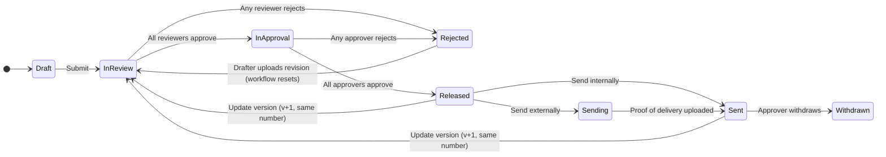
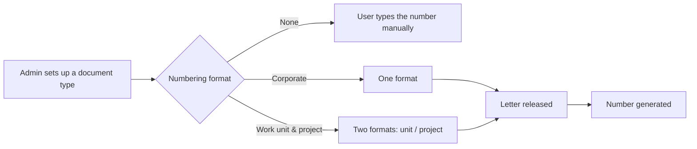
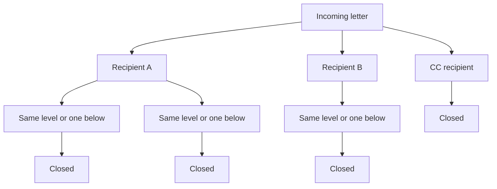
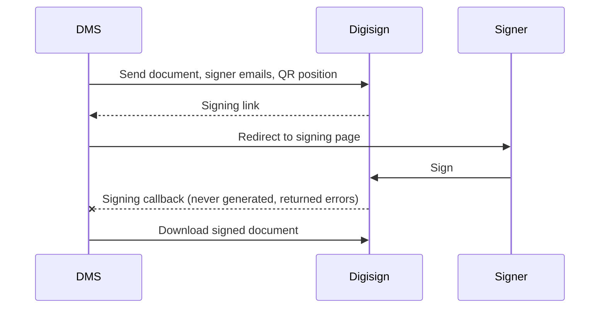

# Enterprise DMS

> 📷 **[Insert cover image: composite of the Dashboard, Disposition tree, and Mobile app screens]**

Category: Document Management
Time: 5 months
Description: 
A web and mobile Document Management System that digitizes official correspondence (incoming letters, disposition chains, outgoing letters with review, approval, and digital signatures) for ~1,000 employees across around 20 roles at a state-owned construction company.

Links: Confidential

Key skills: Business Rules Modeling, Product Requirement Document, Requirement Elicitation, Stakeholder Management, API Integration, Scrum Methodology, User Acceptance Testing, Information Architecture
Tools: ClickUp, Figma
Date: November 15, 2025
Related to: Nodewave

## TL;DR ⚡

I joined as PM two weeks after kickoff and led a 10-sprint build of a web and mobile document management system for a state-owned construction company, replacing a DMS they had used for years. Most of my work was turning their correspondence rules (who reviews, who can see what, how letters are numbered) into requirements engineers could build and admins could configure. The product was in UAT when I left.

| ~1,000 users | ~20 roles | ~90 user stories | 10 sprints |
| --- | --- | --- | --- |

## Team & My Role 👥

| Product Manager | Brendan Alexander Soendjojo (joined 2 weeks after kickoff) |
| --- | --- |
| Product Manager (Kickoff & Initial Discovery) | Sugma Ayunia Dewi Azhara |
| Tech Lead | Rafizhafran Halim |
| UI/UX Designer | Irfan Maulana Sinatrya |
| Frontend Engineers | Andre Wijaya Kok Cyen, Muhammad Timur, Rama Dhaniansyah |
| Backend Engineers | Ahmad Chairiansyah, Muh Syahabuddin Hylmi |
| Mobile Engineer | Dony Ahmad Hisyam |
| Data Engineers | Achmad Nurs Syururi Arifin, Dhafa Alifandra |
| Data Preparation Specialist | Wildan Abdurrasyid |
| Quality Assurance | Refiqa Khoirunnisa |

**What I owned:** completing requirement gathering after Sugma's handover, translating business rules into user stories and acceptance criteria, sprint planning in ClickUp, API implementation together with the backend engineers (including the Digisign integration), client walkthroughs, and UAT testing.

**What I didn't own:** the kickoff and initial discovery (led by Sugma), and visual design.

## The Situation 🏢

The client manages thousands of official documents a year across directorates, work units, and construction projects. They had used their existing DMS for years, but it wasn't serving them well: search was difficult, nothing notified you when a letter needed your action, and management couldn't see where a document was stuck.

I sat down with the Corporate Secretary staff who register incoming letters (*Pendok*) to see how they work. Registering a letter was quick. The slow part came after: directors often took a long time to read and respond, and nothing reminded them a letter was waiting.

| Before | After |
| --- | --- |
| Letters moved through secretaries, printed dispositions, and chat messages | Every letter, disposition, review, and approval lives in one system with a full action log |
| No reminders when a letter was waiting on someone | Notifications to both directors and their Corporate Secretary staff |
| No visibility into where a document was stuck | Role-based dashboards showing pending actions and letter status |
| Hard to find old documents | Folder archive with access control, global search, and an AI assistant |

## Who It Serves 🧑‍💼

Around 20 roles fall into five tiers:

| User | What they need | What we built for them |
| --- | --- | --- |
| **Employees** | Act on letters addressed to them and draft outgoing letters | Personal inbox, outgoing letter workflow, and a dashboard of pending actions |
| **Board Secretaries (Sekdir)** | Register physical letters for their directors | The *Pendok* menu, which puts each letter straight into the right director's inbox |
| **Unit & Project Admins** (Work unit PIC, GM, Project PIC) | Monitor their unit's or project's correspondence | A dashboard of all non-confidential documents in their scope |
| **Super Users** (Corporate Secretary, Board, Internal Audit) | Company-wide oversight | View-only access to all documents |
| **Super Admins** | Keep the rules up to date | 10 master data modules, retention checker, and recycle bin |

## Key Features 🔧

### Role-based Dashboard

<aside>
📊

Each user lands on **the letters that need their action**, where their outgoing letters are stuck, their drafts, activity trends, and documents close to their retention limit. Oversight roles get an extra view of their whole unit, project, or directorate.

</aside>

> 📷 **[Insert screenshot: Dashboard]**

### Incoming Letters & Disposition

<aside>
📥

Receive letters from outside (registered by *Pendok*) or from colleagues, **dispose them down the hierarchy** with notes, reply, and track every action in a document log. Files are watermarked with the viewer's identity to discourage leaks.

</aside>

> 📷 **[Insert screenshot: Incoming letter detail page with metadata, file preview, and action buttons]**

### Outgoing Letters

<aside>
📤

Draft from a **type-specific template in an online editor**, run it through **sequential or parallel review and approval**, place the Digisign QR code, then send internally or externally (email draft or courier with proof of delivery). Approvers can withdraw a sent letter, and drafters can release a new version.

</aside>

> 📷 **[Insert screenshot: Create-letter step with the online editor pre-filled from the template]**

### Folder Management & Access Control

<aside>
🗂️

Every released or uploaded document is archived in one folder structure, protected by a **3-layer access check** (can you open the folder, see the document in the list, open its content?) across 2 categories and 3 security classifications.

</aside>

> 📷 **[Insert screenshot: Folder tree with document list and security classification labels]**

<aside>
🔍

**The platform also covers** board secretary letter registration (*Pendok*), global search with an AI assistant, 10 configurable master data modules, retention monitoring and recycle bin, user, role, and API key management, notifications, and a mobile app for letters and approvals on the go. It integrates with **Digisign** (digital signature), the client's **internal SSO**, and **Zimbra** (corporate email).

</aside>

## Key Decisions 🧭

### Deep-dive 1: Modeling the letter lifecycle as a state machine

**The rule.** An outgoing letter has to pass every reviewer and approver before it becomes official. One rejection sends it back to the drafter. Some letters need reviews one-by-one, others in parallel. Backdated letters must be checked by the Corporate Secretary.

**What I did.** Instead of describing screens, I wrote the lifecycle as explicit states and transitions, so the engineers, QA, and the client could all point at the same diagram:

| Rule | Sequential | Parallel |
| --- | --- | --- |
| Who sees the document | One reviewer at a time, in order | All reviewers at once, then all approvers |
| Visibility of others | Only people before you in the chain | Only your own stage until it completes |
| On rejection | Returned to drafter; old workflow kept as read-only history | Every pending reviewer's and approver's buttons are disabled |

Edge cases I locked down: the Corporate Secretary is auto-inserted as first reviewer for backdated letters, and mandatory reviewers from master data always come before manually added ones.

> 📷 **[Insert screenshot: Outgoing letter detail with the workflow panel mid-review]**

**Result.** "Is it stuck with me or with them?" became answerable from the dashboard, and QA could write test cases straight from the transitions.

### Deep-dive 2: A configurable numbering engine instead of hardcoded formats

**The rule.** Every document type has its own official number format, which depends on whether the letter is corporate-wide or belongs to a work unit or project. Mid-build, the client added a twist: some letter types need one number per approving unit, not one per letter.

**What I did.** I walked through real letters with the client to break each number into its parts, then turned those parts into building blocks an admin can arrange per document type, with no developer involved:

Available blocks: **type code**, **sequence** (001, 002 … continuing past 999 to 1000), **work unit code**, **project code** (regular projects) or **joint-venture initials** (KSO projects), **month (MM)**, and **year (YYYY)**. Example output: `SK/014/UNIT-IT/11/2025`.

> 📷 **[Insert screenshot: Admin screen building a number format from blocks]**

**Why it mattered.** The document type became the configuration hub of the whole system. The same record also decides the online editor template, the archive folder (auto-created), mandatory reviewers, retention period, and security classification. Getting this one master data right meant rules per document type didn't need to be hardcoded.

### Deep-dive 3: When one recipient became many

**The rule change.** Mid-build, the client asked for incoming letters to support multiple recipients instead of one. It looked like a form change, but it broke the disposition model underneath: one disposition tree became several parallel trees, one per recipient and carbon-copy recipient.

**What I did.** I redefined the disposition rules so every tree stays valid on its own while the letter is judged as a whole:

- Each person can dispose only to people at their own level or one level below.
- Each person only sees the branch of the tree that came through them.
- A letter's disposition is closed only when every person at the bottom of every tree has closed their part.

> 📷 **[Insert screenshot: Disposition tree view]**

**Result.** The new model shipped, at the cost of about 2 extra weeks of backend refactoring. The client had set no deadline for this change, and how I handled that is in "What I'd Do Differently."

### Other decisions

**Notifying both directors and their Corporate Secretary staff**

- **Decision:** Pending-letter notifications go to the director and to the Corporate Secretary staff who handle their correspondence.
- **Why:** Directors often took a long time to respond to letters. Two people tracking the same pending letter means it never depends on one person's memory.

**Generating the letter number only at Released**

- **Decision:** An outgoing letter gets its official number only after the last approval, not when it's drafted.
- **Why:** Letters can be rejected and revised many times. Numbering at release means rejected drafts never use up an official number.

**Validating with Hi-Fi designs on dummy data instead of documents**

- **Decision:** I ran client walkthroughs on Hi-Fi designs filled with realistic dummy data rather than on written requirements.
- **Why:** The inherited requirements were still high level. People spot what's wrong with their process much faster on a realistic screen than in a document.

## Challenges 🚧

**Taking over a project mid-discovery**

- **Problem:** I joined two weeks after kickoff, and Sugma's requirement gathering wasn't finished yet. The client was a large state-owned company with many rules, many units, and many edge cases.
- **What I did:** I continued the requirement gathering from where it stopped, then validated each flow with the client through Hi-Fi walkthroughs before it went into a sprint.

**The Digisign integration that slipped a sprint**

- **Problem:** We planned two sprints: backend API integration first, then the frontend signing flow. But the signing callback was never generated. We followed every field in Digisign's documentation and still got errors. The feature was unusable at the end of the sprint.

- **What I did:** I read the API spec with the tech lead and backend engineers to map every request and response field to our data, then ran about **a month of back-and-forth** with Digisign alongside the tech lead. I kept the client informed of the cause and the revised plan, and reassigned engineers to other urgent backlog items so the wait didn't burn capacity. Once Digisign clarified the flow, the integration went straight to the top of the next sprint.

> 📷 **[Insert screenshot: QR code placement on the document preview]**

**Rules that kept arriving mid-build**

- **Problem:** Three major change requests arrived after development started: multiple recipients for incoming letters, multiple numbers for outgoing letters, and a new global search feature.
- **What I did:** For each one, I documented the change, estimated it with the engineers, and updated the requirements so the decision didn't live only in chat. The biggest one is Deep-dive 3.

## Measuring Success 📊

**What I observed**

- The system reached UAT with about 90 user stories, each with testable acceptance criteria, across web and mobile.
- Three major change requests were absorbed mid-build.
- The configurable master data meant rule changes like new letter types or number formats no longer needed a developer.

**What I'd track going forward**

1. **Time to first response:** how long a letter waits before its recipient (especially a director) opens or disposes it.
2. **Draft-to-release cycle time:** from first draft to Released, split by sequential and parallel workflows.
3. **Rejection rate per document type:** to spot letter types whose templates or rules confuse drafters.
4. **Search success:** how often users find a document through search or the AI assistant without asking a colleague.

## What I'd Do Differently 🔁

- **Spike third-party integrations before committing a sprint.** A one-day sandbox test of the Digisign callback would have exposed the problem before I promised a two-sprint timeline.
- **Make the cost of a change visible before saying yes.** The multi-recipient change had no deadline from the client, yet I pulled it in right away and absorbed 2 weeks of refactoring. Next time I'd show which features would slip, and by how long, and let the client choose.
