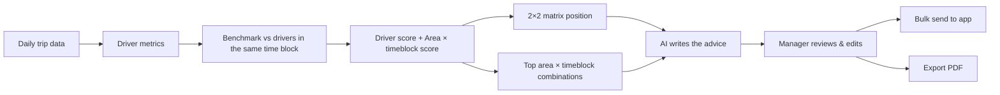
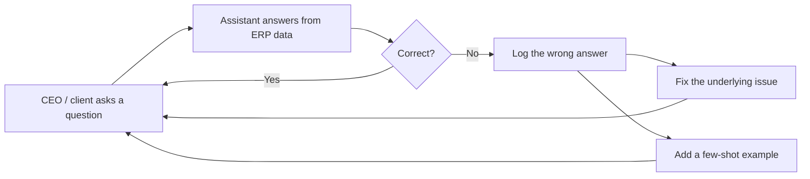

# IM TAXI

> 📷 **[Keep existing cover image: taxi photo + login screen]**

Category: Fleet Management
Time: 6 months
Description: 
A web platform that connects a Japanese taxi company's trip data with its finances, so managers can see which drivers, areas, and hours are profitable, coach every driver daily, and let the CEO ask an AI assistant about the business.

Key skills: Information Architecture, Product Requirement Document, Product Roadmapping, Stakeholder Management, UI/UX Principles, User Flow, User Research, User Testing
Tools: Google Docs, Miro, Visual Studio Code
Date: July 1, 2025
Related to: Nodewave

## TL;DR ⚡

I joined one week into discovery and led a 6-month build of an ERP for a Japanese taxi company. Before it, trip data was recorded manually and finances lived in separate accounting software, so nobody could see which drivers, areas, or hours were profitable. The platform now runs across a fleet of around 200 drivers. The client uploads trip data every month, and it powers dashboards, daily coaching for every driver, and an AI assistant for the CEO.

| 10+ modules | ~200 drivers | 6 months | Team of 8 |
| --- | --- | --- | --- |

## Team & My Role 👥

| Product Manager | Brendan Alexander Soendjojo |
| --- | --- |
| Product Manager (Discovery & Lo-Fi) | Cyntia Jasmine Utomo |
| UI/UX Designer | Irfan Maulana Sinatrya |
| Frontend Engineers | Rama Dhaniansyah, Yanuar Bimantoro Aji |
| Backend Engineers | Ahmad Chairiansyah, Novaldy Hidayat |
| Quality Assurance | Cornelia Rahmawati |

**What I owned:** the PRD for 10+ interconnected modules, metric definitions for engineers, client communication and user testing, hi-fi design direction, and delivery with 2 frontend engineers, 2 backend engineers, and 1 QA, while running Soleil (another ERP project) in parallel.

**What I didn't own:** initial discovery and lo-fi designs (Cyntia), and implementation.

## The Situation 🚕

| Before | After |
| --- | --- |
| Trip data recorded manually | Trip and sales data uploaded monthly into one system |
| Profit, costs, and cash flow in separate accounting software | Accounting inside the same platform |
| No view of performance per driver, vehicle, area, or hour | Dashboards, driver recommendations, and the CEO assistant all draw from the same data |
| No consistent way to coach drivers or base policies on data | Daily, data-backed advice for every driver |

## Who It Serves 🧑‍💼

| User | What they need | What we built for them |
| --- | --- | --- |
| **CEO** | Understand the business and make policy decisions based on data | Executive dashboards and an AI assistant with access to the ERP's data |
| **Admins & Managers** | Run daily operations and coach drivers | Trip, driver, vehicle, and area management, shift assignment, and editable AI recommendations |
| **Drivers** | Know what to improve to earn more | Daily recommendations in a mobile web app, with printed PDFs for drivers who aren't comfortable using the app |

## Key Features 🔧

### Executive Dashboard

<aside>
📈

Management's first view of the business: **total revenue, operating costs, and trips with period-over-period change**, each broken down by morning, afternoon, and night, plus the top 5 areas by revenue and by trips. Tabs let each team jump straight to its own view: Trips, Driver, Vehicle, or Finance.

</aside>

> 📷 **[Keep existing screenshot: Dashboard]**

### Trip List

<aside>
🛣️

Every trip in **one searchable record**: vehicle, boarding and drop-off times and locations, dispatch category, and fare, with time-of-day summaries on top. Trips can be **added manually or bulk uploaded**, and the table can be filtered, sorted, customized, and exported.

</aside>

> 📷 **[Keep existing screenshot: Trip List]**

### Financial Report

<aside>
💹

An **income statement built directly from journal entries**, switchable between Head Quarter and Department views, expandable from category totals down to sub-account codes. At the client's request, we adapted and extended the accounting module from **Soleil**, a sister company's ERP, so the group kept accounting it already trusted. It sits inside a full finance suite: Budget vs. Actual, Balance Sheet, Cashflow, Financial Simulation, Forecast Assistant, and Report Comparison.

</aside>

> 📷 **[Keep existing screenshot: Financial Report]**

<aside>
🔍

**The platform also covers** customer insights, driver shift assignment and timesheets, vehicle performance and accident history, sales performance, and master data.

</aside>

## Key Decisions 🧭

### Deep-dive 1: A driver recommendation engine where rules score and AI writes

**The problem.** Managers had no consistent way to guide drivers. And a driver's raw numbers mean little on their own: a night-shift driver and a morning-shift driver face completely different demand.

**What I did.** I turned "coach the driver" into a pipeline with a clear split between what the rules decide and what the AI does:

- **Metrics:** peak-hour trips, high-demand area trips, revenue per hour, revenue per km, idle time rate, empty km rate, average wait time, and on-time clock-in.
- **Fair benchmark:** each driver is compared against **drivers working the same time of day**, not a company-wide average.
- **2×2 matrix:** driver skill vs. area × timeblock fit tells managers whether a driver should maintain performance, improve their driving, change area or shift, or both.
- **Top combinations:** the system ranks the best area and timeblock combinations by expected score increase, revenue per hour, and revenue per km.
- **Rules score, AI writes:** scores come from defined rules so they stay consistent and explainable. AI only turns them into readable, personal advice.
- **Managers stay in the loop:** I proposed making the AI text prefilled but editable, because managers know their drivers in ways the data doesn't capture.

> 📷 **[Keep existing screenshot: Driver recommendation detail with the 2×2 matrix]**

> 📷 **[Keep existing screenshot: Top recommended area × timeblock list]**

**Result.** Every driver can receive daily, data-backed advice, including elderly drivers through printed PDFs.

### Deep-dive 2: Sourcing government boundary data for the area map

**The problem.** The area map had to show performance at neighborhood level. Google Maps and OpenStreetMap didn't have administrative boundaries detailed enough for that.

**What I did.** I found the Japanese government's open **Administrative District Data (National Land Numerical Information, 2025)** and defined how its raw columns become the platform's municipality master data:

| Platform field | Source logic |
| --- | --- |
| Municipality code (unique ID) | `N03_007` |
| Prefecture | `N03_001` |
| Name | `N03_004` + `N03_005` if a ward exists, otherwise `N03_004` only |
| Type | Ward if `N03_005` exists; otherwise by suffix: 市 → City, 町 → Town, 村 → Village, else Unknown |

I then processed the dataset so the backend could use it directly.

> 📷 **[Keep existing screenshot: Area Performance density map]**

**Result.** A demand density map that colors every neighborhood from very low to very high, with cascading filters: picking a municipality fills in its prefecture automatically, and picking an area fills in both.

### Deep-dive 3: Making a CEO's AI assistant trustworthy

**The problem.** The CEO wanted to ask calculation-heavy business questions in plain language. A wrong answer could lead to a wrong decision.

**What I did.** I treated accuracy as a loop rather than a one-time setup:

- **Few-shot examples:** the prompt includes examples of the questions users typically ask, which teaches the assistant how to calculate and answer similar complex questions.
- **Wrong-answer log:** during user testing with the client, every wrong answer was logged, then either fixed at its source or turned into a new example.
- **What's still open:** the assistant currently works on the full dataset. Role-based data access was scoped as the next milestone.

> 📷 **[Keep existing screenshot: CEO's Assistant]**

**Result.** The assistant became one of the two most active areas of iteration with the client, alongside accounting.

### Other decisions

**Printing recommendations for elderly drivers**

- **Decision:** Admins can export recommendations as PDFs to hand out in person.
- **Why:** All drivers have smartphones, but some elderly drivers struggle to use the app. A printed version makes sure the advice reaches every driver.

## Challenges 🚧

**Taking over a project mid-flight**

- **Problem:** I joined one week in, while discovery was still underway and Cyntia had made initial lo-fi designs. I had to get up to speed quickly on a 10+ module ERP in an unfamiliar domain, with a client already engaged.
- **What I did:** I built on Cyntia's discovery work and lo-fis, then took ownership of the detailed requirements, metric definitions (such as driver pay: commission or hourly wage, whichever is higher), client communication, design direction, and delivery.

**Recovering from a missed deadline**

- **Problem:** Scope and complexity grew, engineering took longer than estimated, and we missed a deadline agreed with the client. At first, I mostly apologized and reported the delay.
- **What I did:** I broke the remaining work into weekly and monthly milestones and gave the client clear updates on what was done, what was in progress, and what was next.

## Measuring Success 📊

**What I observed**

- The client **uploads trip data every month**, the core data that every dashboard and AI feature depends on.
- The CEO assistant and the accounting module were the **most active areas of iteration** with the client.

**What I'd track going forward**

1. **Recommendation edit rate:** how often managers change AI recommendations before sending. Fewer edits over time would signal better AI quality.
2. **Assistant accuracy:** the share of test questions the CEO assistant answers correctly in each round of testing.
3. **Management dashboard usage:** how often management uses the dashboards each week.
4. **Driver improvement:** changes in revenue per hour and idle time for drivers after receiving recommendations.

## What I'd Do Differently 🔁

- **Agree on baselines with the client at the start.** We never did, which made it hard to prove the platform's impact after launch.
- **Define "done" up front**, including how and when the project formally closes.
