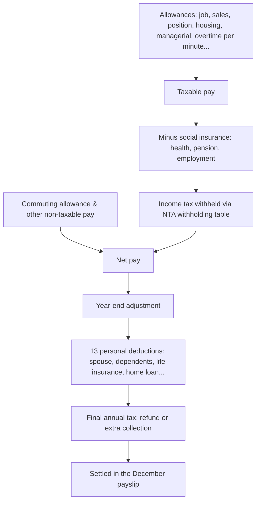
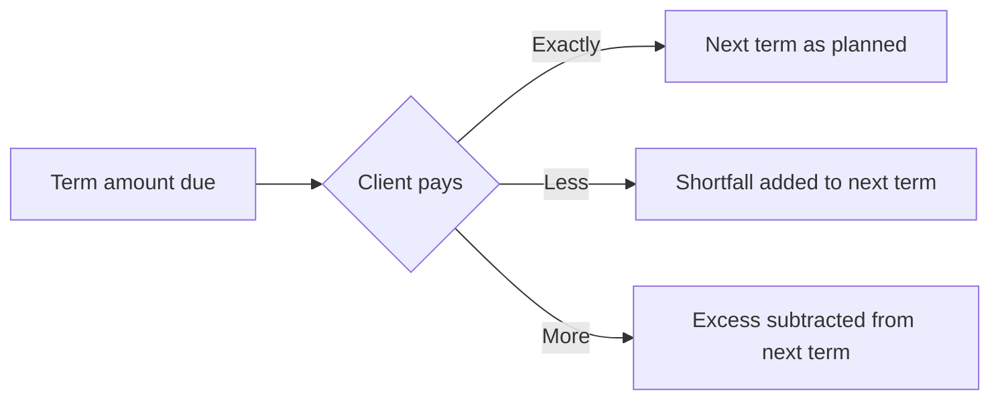

# Soleil

> 📷 **[Insert cover image: Accounting Dashboard + Financial Report composite]**

Category: Financial Management
Time: 9 months
Description: 
An ERP for a Japanese accounting consultancy that connects sales orders, payroll, accounting, and financial statements in one system, with an AI simulator that projects the company's finances years ahead.

Key skills: Business Rules Modeling, Product Requirement Document, Requirement Elicitation, Stakeholder Management, User Acceptance Testing, Scrum Methodology
Tools: Microsoft Teams
Date: July 15, 2025
Related to: Nodewave

## TL;DR ⚡

I took over Soleil from another PM three months into the build, while running IM TAXI in parallel. My part was making the numbers right: I built payroll under Japanese tax rules, rebuilt how orders calculate payments across terms, and finished the financial statements. The product was in UAT when I left.

| ~30 users | 13 year-end deduction types | 5 engineers | 9 months |
| --- | --- | --- | --- |

## Team & My Role 👥

| Product Manager | Brendan Alexander Soendjojo (from mid-July 2025) |
| --- | --- |
| Product Manager (Discovery, PRD & Lo-Fi) | Cyntia Jasmine Utomo (until July 2025) |
| UI/UX Designer | Annisa Safitri |
| Frontend Engineers | Muhammad Abdiel Firjatullah, Rama Dhaniansyah, Reynaldi Antonio |
| Backend Engineers | Rafizhafran Halim, Khawaril Putra |
| Quality Assurance | Refiqa Khoirunnisa |

**What I owned:** I started helping in mid-July and owned the product fully from August. That covered payroll and the year-end adjustment, the revised order payment calculation, the remaining financial statement features, the AI financial simulator change request, and delivery through to UAT.

**What I didn't own:** discovery, the original PRD, lo-fi prototypes, and the finance-first product direction, which Cyntia led in the first three months. You can read about that phase in [her case study](https://cyntiajasmine-product.framer.website/).

## The Situation 💼

The client is an accounting consultancy in Japan that handles accounting, tax, and financial reporting for many clients of its own. Their legacy ERP was generic: full of features nobody used, hard to navigate, and rigid in reporting, so analysis and forecasting took a lot of manual work.

| Before | After |
| --- | --- |
| Generic legacy ERP with unused features | An ERP built around their own sales, payroll, and accounting workflows |
| Prospects processed manually | One flow from prospect to order, invoice, and payment |
| Rigid reports and manual forecasting | Financial statements per head quarter, division, and department, plus an AI simulator |

## Who It Serves 🧑‍💼

| User | What they need | What we built for them |
| --- | --- | --- |
| **Management** | Understand where the business is heading | Dashboards, financial statements, and the AI financial simulator |
| **Finance team** | Close the books and report accurately | Journals, balance sheet, income statement, cashflow, and budget vs. actual |
| **HR & Admin** | Pay everyone correctly and on time | Payroll, payslips, deduction settings, attendance, and leave approval |
| **Sales** | Turn prospects into paid orders | Prospect and order management, invoices, and payment tracking per term |

## Key Features 🔧

### Payroll & Payslip

<aside>
💴

Payslips calculated from **allowances, social insurance, and withholding income tax**, with taxable and non-taxable pay separated. At year end, the system applies the **year-end adjustment** across 13 deduction types, from spouse and dependents to life insurance and home loans.

</aside>

> 📷 **[Insert screenshot: Payslip detail]**

### Order & Invoicing

<aside>
🧾

Every order carries its own **payment schedule**: how many terms, an initial retainer, the service fee, and taxes. When a client pays more or less than planned, the difference **carries over to the next term automatically**.

</aside>

> 📷 **[Insert screenshot: Order form with payment terms]**

### Financial Statements

<aside>
📑

**Balance sheet, income statement, and cashflow statement** built from journal entries, switchable between Head Quarter, Division, and Department views, and expandable from category totals down to individual account codes.

</aside>

> 📷 **[Insert screenshot: Financial Report]**

### AI Financial Simulator

<aside>
🔮

A chatroom where management describes a scenario and the AI **projects monthly financial statements years ahead**, based on the company's past financial behavior, then summarizes the insights.

</aside>

> 📷 **[Insert screenshot: AI Financial Simulator chat]**

<aside>
🔍

**The platform also covers** prospects and consultations, production and delivery tracking, attendance and leave, employee targets and performance, accounting settings, and dashboards.

</aside>

## Key Decisions 🧭

### Deep-dive 1: Payroll and the year-end adjustment under Japanese tax rules

**The rule.** Japanese payroll is a chain where every step depends on the one before it. Monthly, allowances become taxable pay, social insurance comes off, and income tax is withheld. At year end, the **year-end adjustment** recalculates the whole year's tax using each employee's personal deductions.

**What I did.** I mapped the full chain into calculation steps, using the **National Tax Agency's withholding tables** as the source of truth and AI to help interpret regulations written in Japanese:

**The hardest part: dependent deductions.** Every employee's case is different. The deduction depends on each family member's relationship to the employee, age, income, and whether they live together, so the system needs proper family data per employee rather than a single "number of dependents" field.

Following standard practice, the year-end result, whether a refund or extra tax, is settled in the employee's December payslip.

**Keeping it changeable.** Each of the 13 deduction types is a setting with its own adjustment, not a hardcoded number, because tax rules in Japan change from year to year.

> 📷 **[Insert screenshot: Deduction Settings or Year-end adjustment detail]**

**Validation.** The client's representative reviewed and approved the formula for each deduction. The next step, comparing payslips from the old system against the new one, was planned for UAT but hadn't happened when I left.

### Deep-dive 2: A payment model for payments that don't match the plan

**The rule.** The client and their customers agree on payment terms case by case, using company rules that weren't shared with us. And customers don't always pay exactly what's due.

**What I did.** I made the schedule flexible per order and let every difference flow forward:

- **Terms** are set per order rather than from fixed rules.
- **The amount** includes the order value, the company's service fee, and an initial retainer if there is one.
- **Consumption tax** applies to the whole amount. It's 10% by default but can be changed.
- **Sales commission** is calculated for the employee who closed the deal.
- **Any shortfall or overpayment** carries into the next term.

| Term | Planned | Due | Paid | Carried to next term |
| --- | --- | --- | --- | --- |
| 1 | ¥300,000 | ¥300,000 | ¥250,000 | +¥50,000 |
| 2 | ¥300,000 | ¥350,000 | ¥400,000 | −¥50,000 |
| 3 | ¥300,000 | ¥250,000 | ¥250,000 | — |

*Simplified example, before fees and taxes.*

> 📷 **[Insert screenshot: Payment schedule / invoice per term]**

**Result.** The order system reflects how the client gets paid, and nothing is lost when a payment doesn't match the plan.

### Deep-dive 3: From a fixed-rule simulator to an AI simulation chatroom

**The original ask.** A manual financial simulator: the user enters projection inputs, fixed rules calculate the outcome, and scenarios can be compared side by side.

**The change.** After seeing it, the client asked for something different: a chatroom where they describe a scenario in their own words and get projected **monthly financial statements for years ahead**, based on the company's past behavior, with the insights summarized.

**What shipped.** The AI simulation chatroom, as a change request on top of the original scope.

**Why AI does the calculating here.** The client wanted to explore any scenario in their own words, which fixed formulas couldn't cover. That's the opposite of IM TAXI, where the client asked us for a scoring method, so the rules had to stay in control. The cost here is that an AI projection is harder to check than a formula.

## Challenges 🚧

**Taking over a build in progress, in parallel with another project**

- **Problem:** I started helping in mid-July and took full ownership in August, three months into the project, while also running IM TAXI. The domain was new to me, and in a finance product small mistakes have large consequences.
- **What I did:** I built on Cyntia's PRD and discovery, then focused on the parts with the most calculation risk: payroll, payments, and financial statements.

**Three rounds of visual redesign**

- **Problem:** The client asked for a new visual direction three times, each time after seeing the previous redesign. These changes, like the AI simulator, arrived as unofficial change requests.
- **What I did:** I froze design work whenever important tasks were in progress. The redesigns didn't change how the product worked, so they were the lowest priority when they competed with calculation logic.

## Measuring Success 📊

**What I observed**

- The client's representative approved the formula for every payroll deduction.
- The AI financial simulator shipped as a change request on top of the original scope.
- The product reached UAT.

**What I'd track going forward**

1. **Payslip match rate:** the share of payslips that match the old system or manual calculation to the yen.
2. **Payment reconciliation errors:** how often a carried-over balance doesn't match what the client received.
3. **Simulator accuracy:** how closely projected months compare with the actual results once those months close.

## What I'd Do Differently 🔁

- **Compare payslips before UAT, not during it.** Approving formulas one by one isn't the same as proving the final payslip is right. A side-by-side run against real payslips from the old system should have started as soon as payroll was built.
- **Agree on the visual direction before building.** Three redesigns after the client saw each result could have been one, with a design sign-off before development started.
